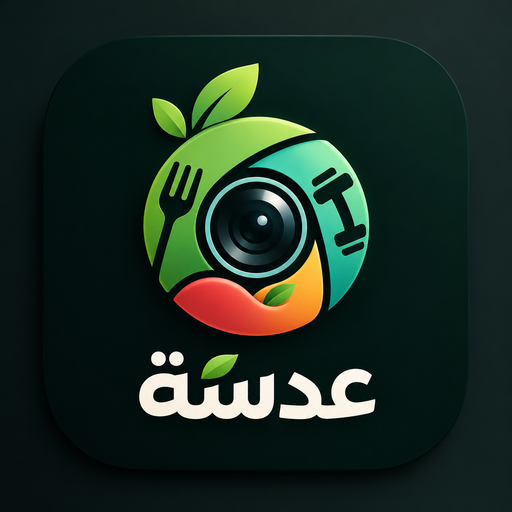
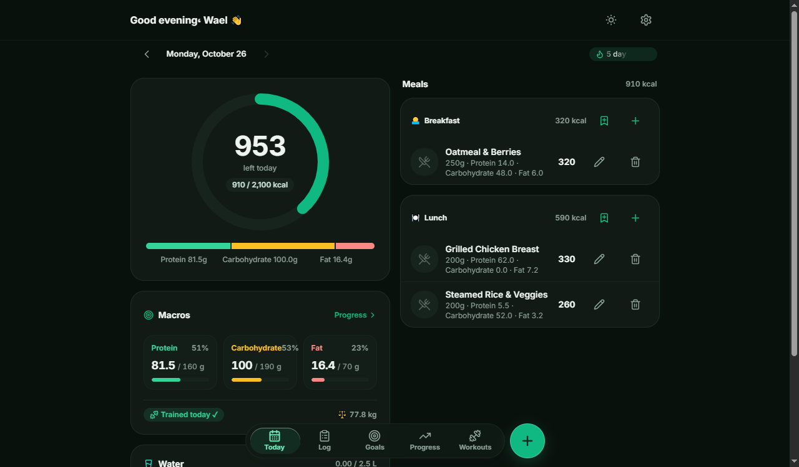
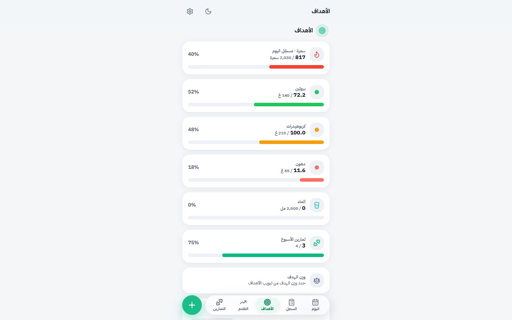
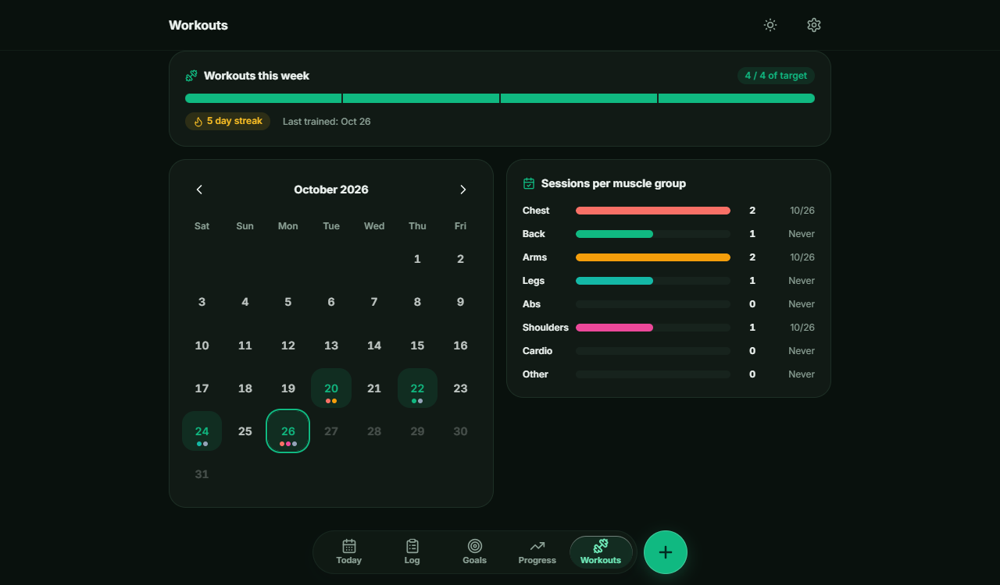
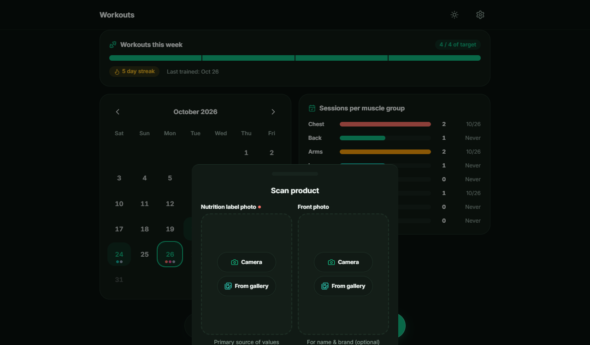
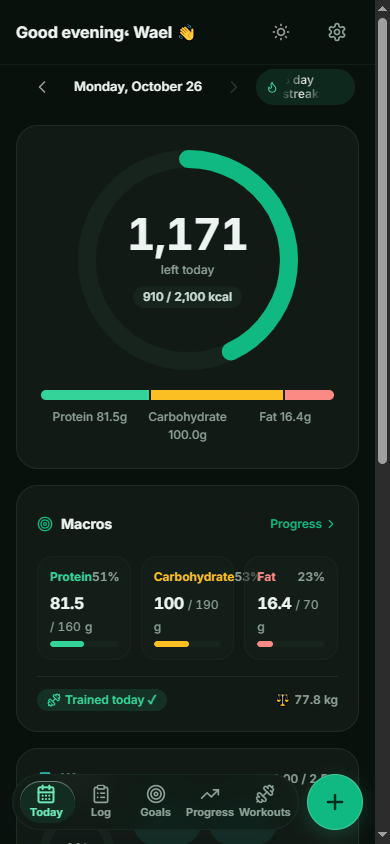
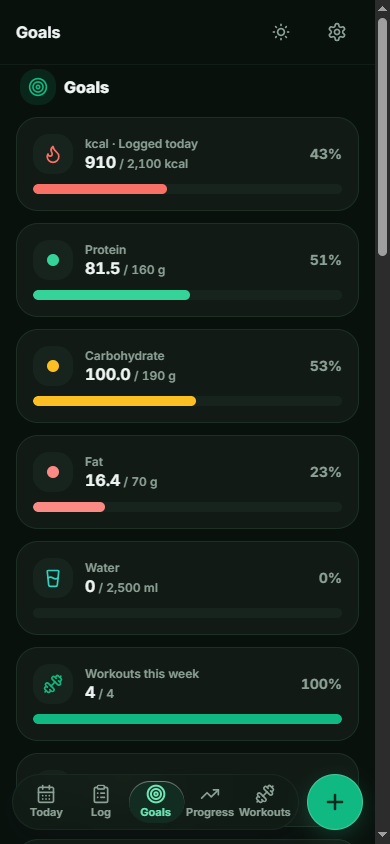
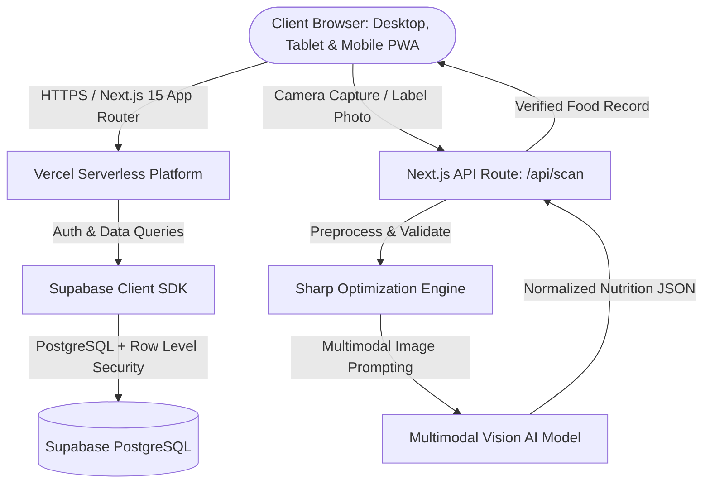

# Adasa (عدسة) — Vision AI Nutrition & Calorie Tracking Platform

<p align="center">
  
</p>

<p align="center">
  <a href="https://adasa-qomra.vercel.app/" target="_blank">
    
  </a>
  
  
  
  
  
  
</p>

<p align="center">
  An intelligent, modern nutrition and fitness tracking web application. Engineered with high-craft responsive ergonomics across desktop, tablet, and mobile, native dark-mode aesthetics, and multimodal Vision AI for automatic nutrition label, barcode, and food recognition.
</p>

---

## 🌐 Live Application

- **Production URL:** [https://adasa-qomra.vercel.app/](https://adasa-qomra.vercel.app/)
- **Deployment Platform:** Vercel
- **Cloud Infrastructure:** Supabase (PostgreSQL 15+, Row Level Security, Supabase Auth)
- **AI Processing:** Multimodal Vision AI Model Endpoint

---

## 📸 Product Gallery (Dark Mode & English UI)

### 1. Desktop & Widescreen Experience
*Interactive calorie rings, macronutrient split (protein, carbs, fat), and metabolic Zigzag caloric cycling:*

<p align="center">
  
  
</p>

### 2. Workouts & Vision AI Scanner
*Muscle group volume tracking alongside camera-assisted nutrition label recognition:*

<p align="center">
  
  
</p>

### 3. Mobile Experience
*Adaptive mobile layout with floating navigation dock and touch-first logging:*

<p align="center">
  
  &nbsp;&nbsp;&nbsp;&nbsp;
  
</p>

---

## ✨ Key Features

- **📸 Multimodal Vision AI Scanner:** Snap a picture of any food plate or nutrition label. The vision model analyzes ingredients, serving size, and extracts accurate calorie, protein, carbohydrate, and fat counts directly into your diary.
- **⚡ Zigzag Caloric Cycling Plan:** Supports flexible metabolic cycling (alternating higher and lower caloric intake days throughout the week) to prevent metabolic slowdown during fat loss or muscle building phases.
- **🎯 Dynamic Macro Targets & Science-Backed Formulas:** Built-in Mifflin-St Jeor and Harris-Benedict algorithms calculate precise Basal Metabolic Rate (BMR) and Total Daily Energy Expenditure (TDEE) with custom percentage/gram splits.
- **🥗 Categorized Daily Diary:** Log breakfast, lunch, dinner, and snacks with a custom meal builder, quick-add macros, and a favorite foods catalog.
- **💧 One-Tap Hydration Tracker:** Log water intake with rapid increments (250ml, 500ml, custom) alongside an active daily progress ring.
- **⚖️ Weight Trend Analysis:** Track scale weights with moving-average trendlines (kg or lb) to filter out daily water weight fluctuations.
- **🏋️ Strength Workout Logger:** Track training frequency, duration, and muscle groups targeted per session.
- **🔒 Enterprise-Grade Security & Isolation:** All health records, custom meals, and weight data are strictly protected by PostgreSQL **Row Level Security (RLS)** in Supabase.

---

## 🏗️ System Architecture



---

## 🛠️ Tech Stack Breakdown

| Layer | Technologies |
|---|---|
| **Framework & Engine** | Next.js 15 (App Router), React 19, TypeScript 5 |
| **Styling & Design System** | Tailwind CSS v4, Lucide React, Shadcn UI primitives |
| **Motion & Physics** | GSAP (`@gsap/react`), Framer Motion |
| **State & Data Fetching** | Zustand (local UI state), TanStack React Query v5 (server sync) |
| **Backend & Cloud Database** | Supabase (PostgreSQL 15+, Row Level Security policies) |
| **Authentication** | Supabase Auth (PKCE flow, Google OAuth, Magic Link & Email) |
| **Vision & Machine Learning** | Multimodal Vision API endpoint with rate limiting & token pooling |
| **Deployment & Edge CDN** | Vercel |

---

## 🚀 Getting Started

### Prerequisites
- Node.js (v18 or higher)
- npm or pnpm
- Supabase Project URL & Anon Key
- Multimodal Vision API Key

### 1. Clone the repository
```bash
git clone https://github.com/Waelkun/ADASA.git
cd ADASA
```

### 2. Install dependencies
```bash
npm install
```

### 3. Configure environment variables
Create a `.env.local` file in the root directory:
```bash
cp .env.example .env.local
```

Fill in your project credentials:
```env
NEXT_PUBLIC_SUPABASE_URL=https://your-project.supabase.co
NEXT_PUBLIC_SUPABASE_ANON_KEY=your-supabase-anon-key

# Multimodal Vision AI Model Credentials
NVIDIA_API_KEY=your-vision-api-key
NVIDIA_MODEL=nvidia/nemotron-3-nano-omni-30b-a3b-reasoning

# Daily Scan Rate Limit per User
SCAN_DAILY_LIMIT=30
```

### 4. Run the development server
```bash
npm run dev
```
Open [http://localhost:3000](http://localhost:3000) to view the application.

### 5. Build for production
```bash
npm run build
npm run start
```

---

## 🔒 Security & Privacy

- All user metrics, dietary logs, and weight records are sandboxed per-user via Supabase **Row Level Security (RLS)**.
- Sensitive vision API keys are executed server-side via Next.js serverless route handlers (`/api/scan`) and never exposed to the client bundle.

---

## 📄 License

Maintained by [Waelkun](https://github.com/Waelkun). All rights reserved.
